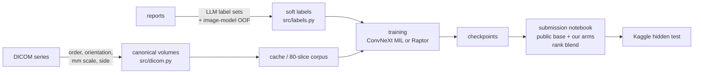

# RSNA Knee Abnormality Detection (Kaggle, 2026)

> **Competition:** [kaggle.com/competitions/rsna-knee-abnormality-detection](https://www.kaggle.com/competitions/rsna-knee-abnormality-detection) · RSNA · research code competition · ended 2026-10-22
> **Team:** theartificialteam (kadirov0, miraysudemutlu) · **Result:** private rank ≈ 1,730 / 6,425 · public 0.958 / private 0.942

Predict 12 knee MRI findings (ACL, MCL, both menisci, three OA compartments, effusion, synovitis, Baker's cyst,
contusion, fracture) for every study. Metric: mean ROC AUC over the 12 findings.

**The knowledge base is in [`docs/`](docs/README.md)**: task and data traps, DICOM preprocessing, labels, models,
blending, infrastructure, the full experiment log, the winners' methods and a playbook for the next competition.


## What is in this repository

```
src/                    our pipeline: DICOM reading, cache, dataset, ConvNeXt multi-view MIL model, training, inference
third_party/raptor/     public Raptor training / inference code with our patches ([KADIROV PATCH] tags)
notebooks/              01-06 main pipeline, 18 public summary
notebooks/raptor/       Raptor retraining (07, 12, 12v3), geometry check (09), inference gold check (17)
notebooks/corpus/       80-slice corpus build (11) and its transport to a GPU server (14, 16)
notebooks/submission/   final blend (10), the two finals (10sa, 10t) and the public base recipe
scripts/                Kaggle push / CLI, LLM report labelling, labels v4, blend variants, doc figures
scripts/server/         training queue and download scripts for a local GPU server
docs/                   knowledge base with diagrams and figures
tests/                  local end-to-end smoke test
```

## Pipeline at a glance



## Notebooks

| # | notebook | runs on | what it does |
|---|---|---|---|
| 01 | [`01_exploratory_data_analysis`](notebooks/01_exploratory_data_analysis.ipynb) | local | data structure, label co-occurrence, report languages, sequences |
| 02 | [`02_labels`](notebooks/02_labels.ipynb) | local (executed) | audit label sources on the 58 gold studies, build the label table |
| 03 | [`03_dicom_preprocessing`](notebooks/03_dicom_preprocessing.ipynb) | local (executed) | every preprocessing step shown on one study |
| 04 | [`04_cache_kaggle`](notebooks/04_cache_kaggle.ipynb) | Kaggle CPU | cache of all 4,407 training studies |
| 05 / 05b | [`05_train_kaggle`](notebooks/05_train_kaggle.ipynb) | Kaggle GPU | ConvNeXt multi-view MIL, 5 folds |
| 06 | [`06_submission_kaggle`](notebooks/06_submission_kaggle.ipynb) | Kaggle GPU | guarded inference and rank blend |
| 07 / 12 / 12v3 | [`raptor/`](notebooks/raptor) | Kaggle GPU | Raptor CoAtNet-384 on 44- and 80-slice corpora, labels v2 / v3 |
| 09 / 17 | [`raptor/`](notebooks/raptor) | Kaggle | corpus geometry recovery; inference vs training gold check |
| 11 / 14 / 16 | [`corpus/`](notebooks/corpus) | Kaggle CPU | 80-slice corpus, npz per study, 30 tar archives for the server |
| 10 / 10sa / 10t | [`submission/`](notebooks/submission) | Kaggle GPU | final blend notebook and the two final submissions |
| 18 | [`18_competition_summary_kaggle`](notebooks/18_competition_summary_kaggle.ipynb) | Kaggle | public post-competition summary |

## Setup

```bash
pip install -r requirements.txt
cp .env.example .env                                   # KAGGLE_API_TOKEN=... (never commit it)
python tests/smoke_test.py                             # local end-to-end check (needs one test study in data/test_series)
python scripts/kaggle_push.py src                      # src/ + third_party/ + labels -> private dataset rsna-knee-src
python scripts/kaggle_push.py kernel 04                # run a notebook as a private Kaggle kernel
python scripts/kaggle_cli.py competitions submissions rsna-knee-abnormality-detection
```

Competition data is not included and must not be redistributed (competition rules).

## Key lessons (details in [docs/09_playbook.md](docs/09_playbook.md))

1. The winners' edge was **labels read from the images** by multimodal LLMs (gold 0.94–0.956 versus ~0.90 from reports).
2. **58 gold studies could not steer decisions**: our pseudo labels gained +0.021 on gold and +0.001 on the leaderboard.
3. A blend member must be **strong and different**: with ρ ≈ 0.86 it needs ≈ 0.949 alone to add +0.002 to a 0.958 base.
4. Silent failures are the most expensive bugs: our first submission scored 0.500 without a single error message.

## Credits

Built on public work by dreaddevelopment (Raptor), heliosli and nartaa (public blends and checkpoints), goodpjw2008
(2.5D reader) and label sets by stevenleehans, pilkwang, NTejas-1 and riadmohamed42. Full list:
[docs/10_glossary_and_references.md](docs/10_glossary_and_references.md).
