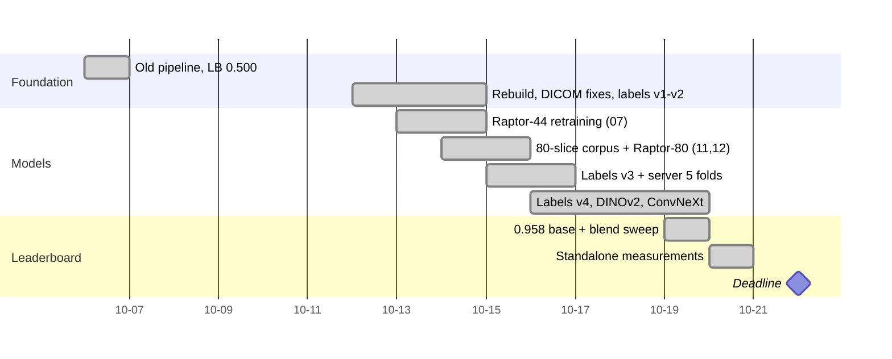

# 01 · Competition

[← index](README.md)

## Task

For every knee MRI study (`StudyInstanceUID`) predict the probability of 12 findings:

| group | findings |
|---|---|
| ligaments | ACL, MCL |
| menisci | Medial Meniscus, Lateral Meniscus (tears) |
| osteoarthritis | Medial OA, Lateral OA, PF OA (patellofemoral) |
| joint | Effusion, Synovitis, Baker's (popliteal cyst) |
| bone | Contusion, Fracture |

**Metric:** mean ROC AUC over the 12 findings. Only the **order** of studies within each column matters, which is why
models are combined by averaging ranks (see [05](05_blending_and_submission.md)).

## Data facts that shaped everything

| fact | consequence |
|---|---|
| 4,407 training studies, **only 58 have the 12 labels** ("gold"), graded by radiologists from the images | every other label must be derived; gold is the only ground truth and it is tiny |
| every training study has a free-text radiology report in 8+ languages (English 43%, French 24%, Spanish 17%, Dutch/German 16%) | labels come from reading reports with LLMs; regex rules fail across languages |
| **test studies have no reports** | text is a training-time signal only; no text + image fusion at inference |
| 3–14 series per study (mean 5.5), every study has sagittal, coronal and axial planes | multi-view models, no missing-plane handling |
| ~3.2 fluid-sensitive / fat-suppressed series per study | sequence type matters for effusion, synovitis, contusion |
| DICOM file names are random SOP Instance UIDs | file order ≠ slice order (ρ ≈ −0.3 … +0.4); see [02](02_data_and_dicom.md) |
| about half the studies lack a `Laterality` tag | the knee side must be derived from geometry |
| experts mark many mild findings that reports do not mention (58 gold: 240 expert positives vs 154 report positives) | report-only labels have a ceiling near 0.90 gold AUC |

## Rules and format

* **Code competition:** a Kaggle notebook is re-run on the hidden test set; ≤ 9 hours, internet off.
* 5 submissions per day (UTC days), 2 final selections; the final selection must be marked by hand.
* Commercial LLM APIs may be used to label the reports (host ruling, discussion 733965).
* External data must be "publicly available and equally accessible to all participants at no cost"; datasets that need
  an institutional agreement are not allowed. OAI (Osteoarthritis Initiative) was a grey zone: individual registration
  works from some countries but Login.gov blocks others (we got error `LG22`).
* Public leaderboard ≈ 30% of the test set (~640 studies), private ≈ 70%.

## Timeline of our participation

