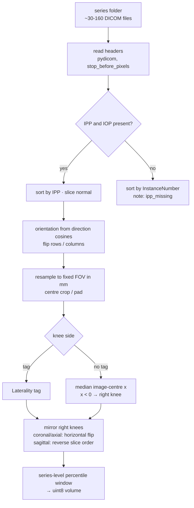

# 02 · Data and DICOM preprocessing

[← index](README.md) · code: [`src/dicom.py`](https://github.com/TriTetra/RSNA-Knee-Abnormality-Detection/blob/main/src/dicom.py), [`src/cache.py`](https://github.com/TriTetra/RSNA-Knee-Abnormality-Detection/blob/main/src/cache.py) ·
notebook: [`03_dicom_preprocessing`](https://github.com/TriTetra/RSNA-Knee-Abnormality-Detection/blob/main/notebooks/03_dicom_preprocessing.ipynb)

Our first submission scored **0.500**. Not because the model was bad, but because the pipeline failed silently.
Four traps in this data set raise no error and quietly destroy a model.

## The four silent traps

| # | trap | what goes wrong | fix |
|---|---|---|---|
| 1 | **slice order** | file names are random UIDs; `sorted(glob("*.dcm"))` shuffles slices, so a "2.5D window" of three neighbours is three random slices | sort by `ImagePositionPatient · normal`, the position along the slice normal |
| 2 | **orientation** | scanners store the same plane flipped or mirrored | use the dominant axes of the row/column direction cosines (`ImageOrientationPatient`) to bring every series to one orientation |
| 3 | **physical scale** | pixel spacing varies between series | resample to a fixed field of view in mm (160 mm for our cache, 140 mm for Raptor) |
| 4 | **right vs left knee** | medial and lateral findings swap sides in the image | mirror right knees to the left-knee view |
| + | intensity | per-slice normalisation changes contrast slice by slice | one percentile window per series |
| + | silent fallback | our old kernel wrote prior values when DICOMs or checkpoints failed → AUC 0.5 | strict loading, failure-rate limits, constant-prediction checks |

## Coordinates (DICOM / LPS)

+x towards the patient's **left**, +y **posterior**, +z towards the **head**. The slice normal is `row × column`
of `ImageOrientationPatient`; its dominant axis tells the plane (x → sagittal, y → coronal, z → axial).

## Measured on the data

| check | result |
|---|---|
| file-name order vs true order (Spearman ρ, 15 test series) | −0.31 … +0.42, i.e. random |
| `InstanceNumber` vs true order | ±1: correct order, but the direction depends on the scanner |
| side from geometry vs `Laterality` tag (2,146 studies with both) | **98.5%** agreement |
| studies without a side tag | 2,152 of 4,407 (side from geometry), 55 undecided (too close to the midline) |
| cache of 4,407 studies (6 slots, 16 slices, 224 px, 160 mm) | 0 read errors, ~12 GB, ~1 h on 4 CPUs |
| compressed DICOMs (JPEG Lossless / JPEG 2000) | need `pylibjpeg`, `openjpeg`, `gdcm`; shipped as offline wheels (`ensure_decoders()`) |

## Two input layouts we used

| | our cache (`src/cache.py`) | Raptor corpus (`third_party/raptor`) |
|---|---|---|
| slots | 6: (sagittal, coronal, axial) × (fluid-sensitive, T1) | 5: sag-fluid, sag, cor-fluid, cor, axial |
| slices | 16 per slot from the central 80% | 44 (public corpus) or **80** (ours: 22/18/15/10/15) |
| crop / size | 160 mm → 224 px | 140 mm → 336 px |
| span | central 80% | 0.15–0.85 (44) or 0.02–0.98 (80) |

**Geometry must match between training and inference.** The public 44-slice corpus came without its exact geometry;
notebook [09](https://github.com/TriTetra/RSNA-Knee-Abnormality-Detection/blob/main/notebooks/raptor/09_raptor_geometry_check_kaggle.ipynb) recovered it by re-processing training studies
with candidate settings and comparing pixels (span 0.15–0.85 + 140 mm → correlation 1.000; the inference default
0.06–0.94 gave only 0.754). Notebook [17](https://github.com/TriTetra/RSNA-Knee-Abnormality-Detection/blob/main/notebooks/raptor/17_inference_gold_check_kaggle.ipynb) later confirmed that
our inference pipeline reproduces the training-time gold AUC (0.9227 vs 0.9205).

## Reusable snippet

The self-contained version (geometric order + knee side) is in the public summary notebook,
[`18_competition_summary_kaggle`](https://github.com/TriTetra/RSNA-Knee-Abnormality-Detection/blob/main/notebooks/18_competition_summary_kaggle.ipynb), section 3.
