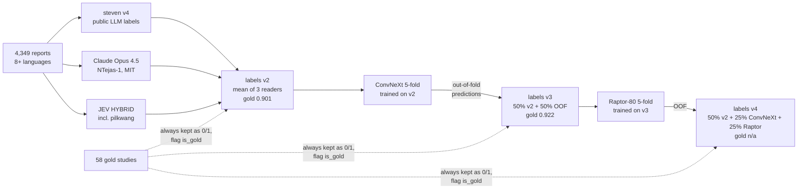

# 03 · Labels

[← index](README.md) · code: [`src/labels.py`](../src/labels.py), [`scripts/llm_label.py`](../scripts/llm_label.py),
[`scripts/build_labels_v4.py`](../scripts/build_labels_v4.py) · notebook: [`02_labels`](../notebooks/02_labels.ipynb)

## Why labels were the bottleneck

Only 58 of 4,407 training studies have expert labels, and they were graded **from the images**. Everything else must be
derived from reports, which miss mild findings: on the 58 gold studies experts marked 240 positives, reports state 154
(PF OA: 21 versus 2). A model trained on report labels learns the reports' blind spots.

## What we built

| version | recipe | gold AUC | leaderboard effect |
|---|---|---|---|
| v1 | mean of steven v4 + pilkwang v2 | 0.8927 | — |
| **v2** | mean of steven v4 + Claude Opus 4.5 + JEV HYBRID (pilkwang is inside JEV) | **0.9014** | Raptor-80 alone public 0.928 |
| v3 | 50% v2 + 50% ConvNeXt 5-fold out-of-fold predictions (teacher-student) | 0.9223 (bootstrap 90% CI +0.007…+0.035) | public 0.929 (+0.001) |
| v4 | 50% v2 + 25% ConvNeXt OOF + 25% Raptor-80 OOF | — (OOF has no gold) | public 0.926 (−0.003 vs v3) |

**Why v3 looked great and did not help:** the v3 label contains our image model's predictions, and the gold score of those
predictions is itself optimistic (epoch selection on gold, small n). The gain was real on the 58 studies and absent on
the ~1,300 hidden ones. See [09 · Playbook](09_playbook.md).

## Our own LLM labelling attempts

`scripts/llm_label.py` labels reports with any OpenAI-compatible server (vLLM, Ollama, commercial APIs).

| model | output | gold AUC | note |
|---|---|---|---|
| Qwen2.5-7B (Kaggle 2×T4) | P / A / N / U letters | 0.797 | OOM on the longest reports until token-budget batching |
| Qwen3.5-27B (RTX 5090, Ollama) | letters | 0.828 | |
| Qwen3.5-27B, thinking mode | letters | — | 57 min for 58 reports, 67% of answers truncated |
| Qwen3.5-27B | **0–100 graded score** | 0.881 | graded scores keep ranking information (+0.053) |
| any of the above added to v2 | | 0.895–0.900 | never improved v2 → not used |

**Letters vs scores:** AUC needs a ranking. Asking for a 0–100 probability with a calibration rubric (explicitly normal
0–5, not mentioned 5–15, suspected 40–60, definite 80–100) beat P/A/N/U letters by +0.053.

## What the winners did instead (the lever we missed)

| team | label method | gold AUC |
|---|---|---|
| 2nd (azamat1ch) | GPT-6.1 read each report in its own language, six-way answer + 0–100 score | 0.899 |
| 2nd | **GPT-6 Astra read every slice (~277 images per exam) with the report** | **0.942** |
| 2nd | + PF OA from the report reader, lateral pass without report, teacher OOF mix, PF OA floor | 0.956 |
| 7th (BarryZhou) | three image-aware reads (structured, image-only, verification) blended; per-hospital synovitis correction; cross-model teacher | 0.952 |
| 1st (Team Kangaroo) | agentic labelling: one CLI agent session per study with slice-viewing tools; probabilities, ROI boxes per finding, per-slice lesion boxes | ~0.936–0.943 (labels) + boxes |

Common pattern: **show the images to a strong multimodal model together with the report**, ask for evidence before the
probability, and then mix in out-of-fold teacher predictions. Details in [08](08_results_and_winners.md).

## Label tips we confirmed

* Average independent readers; do not "pick the best source on gold" (58 studies cannot separate them, and it leaks).
* Keep gold studies with their 0/1 labels and flag them; weight them 2× if trained on.
* Soft labels + plain BCE; a fixed `pos_weight` from biased report rates is wrong.
* steven v4 uses exactly 0.25 to mean "not addressed in the report" (~19% of cells); treat it separately.
* Group CV folds by normalised report text: 4,407 studies share only 4,257 unique reports (a boilerplate normal report
  appears 37 times), from the 499th-place write-up.
