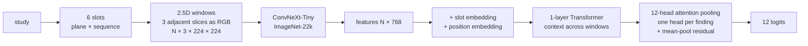

# 04 · Models

[← index](README.md) · code: [`src/model.py`](https://github.com/TriTetra/RSNA-Knee-Abnormality-Detection/blob/main/src/model.py), [`third_party/raptor/train_knee.py`](https://github.com/TriTetra/RSNA-Knee-Abnormality-Detection/blob/main/third_party/raptor/train_knee.py)

## Two model families we trained

### A. Our own pipeline: ConvNeXt-T multi-view MIL (`src/`)

* One attention head per finding because each finding is best seen on a different plane (ACL sagittal, MCL coronal,
  PF OA axial); averaging windows would dilute a tear visible on 2–3 slices.
* No random horizontal flip: right knees are already mirrored, a flip would swap medial and lateral.
* Training: soft-label BCE, 2× weight on gold, AdamW (backbone 1e-4, head 5e-4), cosine schedule with warm-up, fp16.
* **Result:** 5-fold OOF gold AUC 0.890; correlation with Raptor 0.84 (different errors, but too weak to help).

### B. The Raptor recipe (dreaddevelopment), retrained with our labels

CoAtNet-RMLP-2 at 384 px, 2.5D windows (12 per study in training, 24–78 at evaluation), finding-specific attention MIL,
top-3 epoch weight averaging (SWA). We patched the public training script for T4 (fp16 + GradScaler), time budgets,
sharded corpora and per-study npz files (`[KADIROV PATCH]` tags).

| run | corpus | labels | backbone | gold AUC | public alone |
|---|---|---|---|---|---|
| 07 | 44-slice public | v1, no norm | CoAtNet-384 | 0.888 | — |
| 07b | 44-slice public | v2 + ImageNet norm | CoAtNet-384 | 0.8965 | — |
| 07c | 44-slice public | v2, seed 7 | CoAtNet-384 | 0.9053 | — |
| 12 / 12b / 12c | **80-slice (ours)** | v2, seeds 42/7/13 | CoAtNet-384 | 0.9056 / 0.9070 / 0.9009 | 0.928 (12+12b) |
| 12v3 (s101) | 80-slice | v3 | CoAtNet-384 | 0.9205 | **0.929** |
| server s404 / s505 | 80-slice | v3 | CoAtNet-384 | 0.9177 / 0.9216 | — |
| server f0–f4 | 80-slice | v3, 5 folds (80% data) | CoAtNet-384 | 0.9121 / 0.9084 / 0.9041 / 0.9078 / — | — |
| server s202 / s303 | 80-slice | v4 | CoAtNet-384 | 0.9110 / 0.9186 | 0.926 (s303) |
| server | 80-slice | v4 | ConvNeXt-S 384 | 0.8950 | — |
| server s202 / s303 | 80-slice | v3 | **DINOv2 ViT-B, 336 px** | 0.9045 / 0.9116 | — |

Observations
* Folds and seeds of the same recipe correlate at r ≈ 0.96–0.97, so they add almost nothing to each other.
* DINOv2 is a genuinely different family (r = 0.949 with CoAtNet) but weaker; blends on gold stayed flat.
* Patch-14 ViTs need a resolution divisible by 14: 384 crashed, 336 (= 24 × 14, the corpus' native size) worked.
* The Raptor author reported a single CoAtNet-384 at ~0.936–0.938 public; Danial Zakaria's write-up starts the same
  80-slice recipe at **0.939** and reaches 0.949 only with OAI external data and the 384 full-field recipe.

## What the strong teams trained instead

| team | best single model (public) | notes |
|---|---|---|
| 2nd | ConvNeXt-T 5-fold **0.959**; EfficientNetV2-S 0.956; CoAtNet 0.952 | 2.5D MIL, knee-centred close-ups, fastMRI-pretrained encoder |
| 7th | one 2.5D label-query network, 0.969 public / 0.958 private | no external data; 13 fixed zoomed regions as extra series; 4 backbones |
| 25th | ConvNeXt-T 2.5D 0.953; DINOv2 ViT-S 0.951 | pseudo labels |
| 1st | per-slice ConvNeXt-T with **ROI box pooling** from a learned 3D ROI detector | boxes came from LLM-agent labelling |

**Takeaway:** in the same pipeline, ConvNeXt-T beat CoAtNet; resolution was not decisive (224 px models reached 0.95);
labels and where the model looks (ROI crops, close-ups) were.

## Hardware notes

| where | GPU | Raptor-80 CoAtNet-384, 8 epochs |
|---|---|---|
| Kaggle | T4 16 GB, bs 4, fp16 | ~9–10 h (one session) |
| local server | RTX 5090 32 GB, bs 8, bf16 | ~1–1.2 h; DINOv2-B 336 px ~35 min |
