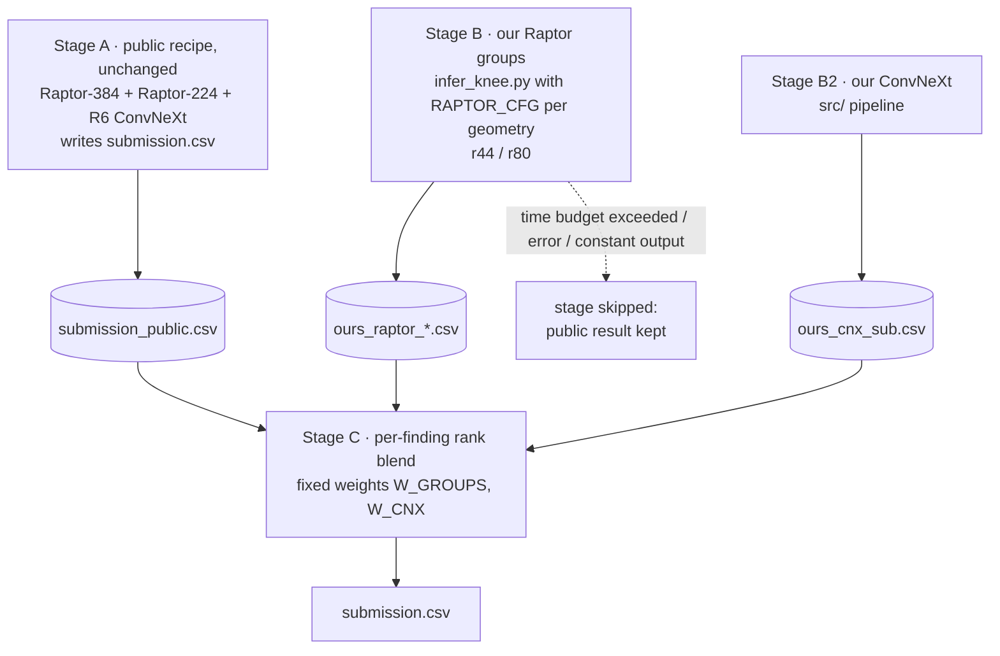
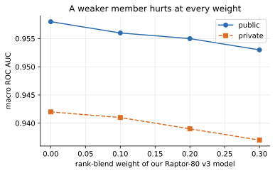
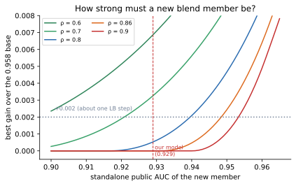

# 05 · Blending and submission

[← index](README.md) · code: [`src/inference.py`](https://github.com/TriTetra/RSNA-Knee-Abnormality-Detection/blob/main/src/inference.py), [`scripts/make_blend_variants.py`](https://github.com/TriTetra/RSNA-Knee-Abnormality-Detection/blob/main/scripts/make_blend_variants.py) ·
notebooks: [`submission/`](https://github.com/TriTetra/RSNA-Knee-Abnormality-Detection/tree/main/notebooks/submission)

## Rank blending

AUC only depends on the order of studies, so models are combined per finding by averaging **percentile ranks**:

```
final[:, finding] = Σ_m  w_m · rank_pct(pred_m[:, finding])  /  Σ_m w_m
```

Ranks remove scale differences between models. A study that one model failed on takes the other models' rank.

## The submission notebook (stages)



Safety rules that saved us: every stage writes its own file; a failed or slow stage is skipped and the public result
stays; weights are fixed before running and never tuned on the public LB; constant predictions are rejected.
The time budget matters: our three-model variant (10sh) silently fell back to the public base because the arms did not
fit in the hidden-test time.

## When does a new model help a blend?

A simple binormal model: per finding each model's score is signal plus Gaussian noise; two models' noise correlates
with ρ. A model alone has AUC = Φ(d/√2). With weight w:

```
AUC(w) = Φ( ((1−w)·d₁ + w·d₂) / √(2·((1−w)² + w² + 2w(1−w)ρ)) )
```

It reproduced our four blend submissions within ±0.0002:



How strong a new member must be on its own to add +0.002 to a 0.958 base:



| error correlation ρ with the base | standalone public AUC needed |
|---|---|
| 0.60 | ≥ 0.900 |
| 0.70 | ≥ 0.921 |
| 0.80 | ≥ 0.940 |
| 0.86 (public models among themselves) | ≥ 0.949 |
| 0.90 | ≥ 0.954 |

Our ≈0.929 models from the same CoAtNet family were neither strong nor different enough. One forum team reported
+0.004 from a member with ρ = 0.83, consistent with the curve. Caveat: four rounded scores cannot separate strength
from correlation; the useful output is the threshold table, and a model's standalone LB score should be measured
directly.

## Kaggle code-competition mechanics we learned

* The "save" run of a submission notebook sees only the 3 visible test studies (~10 min of GPU quota); the scoring
  re-run on ~1,300 hidden studies takes hours but is not charged to the weekly quota.
* Scoring queues get long in the last week (4–9 hours per submission).
* Daily submission limits reset at **UTC midnight**, not local midnight.
* Public notebooks can break later: a dataset the 0.9586 recipe depended on was overwritten with a different model
  bundle; pin or copy the exact inputs (we used the `-w1` copy).
* Ties on the displayed score (1,272 teams at 0.958) are ordered by submission time; private ranks reshuffle anyway.

## Our submissions

| key | content | public | private |
|---|---|---|---|
| 10sa | public 0.958 recipe (final 1) | 0.958 | 0.942 |
| 10t | public 0.9586 recipe = 0.958 + 2.5D reader, fixed 50/50 (final 2) | 0.958 | 0.942 |
| 10sb / 10sc / 10sd | + our Raptor-80 v3 at 10 / 20 / 30% | 0.956 / 0.955 / 0.953 | 0.941 / 0.939 / 0.937 |
| 10se | + (Raptor-80 v3 0.7 + DINOv2 0.3) at 20% | 0.955 | 0.939 |
| 10sf / 10sg | our Raptor-80 v3 / v4 alone | 0.929 / 0.926 | 0.915 / 0.911 |
| 10r | our Raptor-80 v2 alone | 0.928 | 0.913 |
