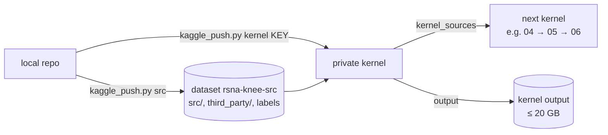
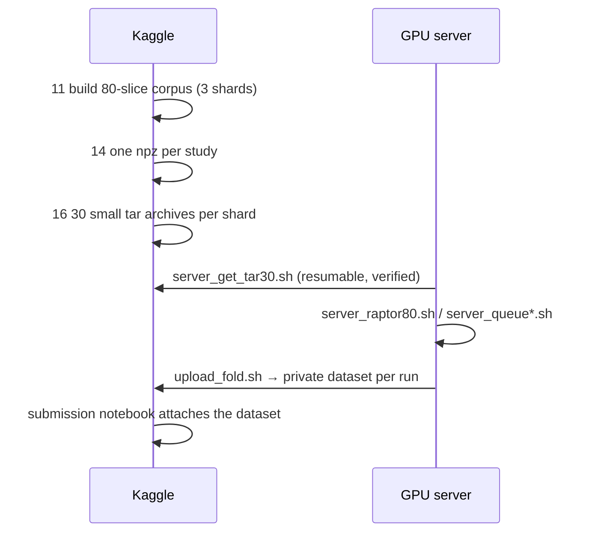

# 06 · Infrastructure

[← index](README.md) · code: [`scripts/kaggle_push.py`](../scripts/kaggle_push.py), [`scripts/server/`](../scripts/server)

## Kaggle



| limit | value | what we did |
|---|---|---|
| GPU quota | 30 h per week per account, resets on Saturday | ran kernels on the teammate's account (`--token-file .env.teammate --as USER`) |
| concurrent GPU sessions | 2 per account | queued pushes; one T4×2 session can train two folds |
| kernel output | 20 GB | the 40 GB corpus was built in 3 shards |
| `rglob` on `/kaggle/input` | walks ~730k DICOMs, minutes | `src.config.find_input` prunes the DICOM folders |
| CLI 1.7.x | cannot paginate kernel outputs, cannot use new `KGAT_` tokens | CLI 2.x in a separate Python 3.11 env; `--file-pattern` for single files |
| private datasets across accounts | a teammate cannot read your private dataset unless shared | copy checkpoints into one account before the final notebook |
| one account per person | multiple accounts are against the rules (Kaggle and Colab) | no extra accounts |

## Local GPU server (RTX 5090, 32 GB)



A CoAtNet-384 run took ~1 h on the server versus ~9 h on a Kaggle T4, so the server did most of the training.

## Failures, their cost and the fix

| failure | cost | fix (now in the scripts) |
|---|---|---|
| silent fallback in the old submission kernel | LB 0.500 | strict loading, failure-rate and constant-prediction guards |
| old CLI could not paginate kernel outputs | corpus half downloaded | CLI 2.x, single-file downloads |
| 3 GB archives dropped mid-download (`IncompleteRead`) | hours of retries | 30 archives of ~330 MB, each verified with `tar -tf` |
| tmux sessions killed by other tooling on the shared server | a night of training | `setsid nohup`, later a private tmux socket (`tmux -L rsna`) |
| queue started without the Python venv (`No module named numpy`) | a whole night lost | queue scripts activate the venv themselves |
| `kaggle: command not found` in the upload step made the run "fail" | every fold trained 3 times, ~3 GPU hours | upload is a separate step; its failure no longer fails the training |
| watcher looked for a file in a listing that did not show it | GPU idle ~3.5 h | check by downloading the file, not by listing |
| DINOv2 at 384 px (not divisible by patch 14) | one run | `RES=336` |
| background job on the laptop died when it went to sleep | ~5 h of scoring delay | never schedule overnight work on a sleeping laptop |
| a Kaggle token pasted into chat | security incident | token in `~/.kaggle/access_token` (chmod 600), read with `read -rs`; token rotated |
| shared server disk at 98–99% | risk of failed checkpoints | delete fold checkpoints once uploaded |

## Reproducing a run

```bash
python scripts/kaggle_push.py src                      # code + labels -> rsna-knee-src
python scripts/kaggle_push.py kernel 11_0              # corpus shard 0 (also 11_1, 11_2), then 14_*, 16_*
# on the GPU server:
bash scripts/server/server_get_tar30.sh                # corpus -> ~/rsna/corpus80_npz
SEED=101 LABELS=train_labels_v3.csv bash scripts/server/server_raptor80.sh
```
