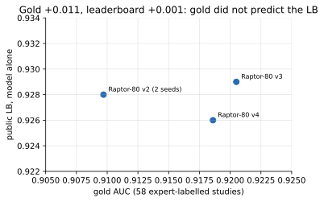

# 07 · Experiment log

[← index](README.md)

Chronological record of every experiment with its numbers. "Gold" = macro AUC on the 58 expert-labelled studies.
"Public" / "private" = Kaggle leaderboard.

| date | experiment | setting | result | decision |
|---|---|---|---|---|
| 10-06 | first submission (old pipeline) | ResNet34, old kernel | **public 0.500** | diagnosis: checkpoint keys did not match, kernel silently wrote priors |
| 10-13 | label source audit | steven v4 / pilkwang v2 / 50:50 mean | gold 0.8927 / 0.8704 / 0.8927; bootstrap diff 90% CI [−0.007, +0.005] | average readers instead of picking one |
| 10-13 | weak findings | mean labels | Synovitis 0.79, Lateral OA 0.81, Fracture 0.82, Contusion 0.85 | priority for relabelling |
| 10-13 | slice order test | file name vs geometry | Spearman ρ 0.09–0.31; InstanceNumber ±1 | geometric sorting is mandatory |
| 10-13 | public 0.957 blend (private copy) | heliosli recipe | **public 0.956**, private 0.940; rank 5,896 → 723 | baseline |
| 10-14 | cache of 4,407 studies (Kaggle CPU) | 6 slots / 16 slices / 224 px / 160 mm | 0 read errors; side from tag 2,200, geometry 2,152, undecided 55; tag–geometry agreement 98.5% | cache v1 kept |
| 10-14 | Raptor retrain 07 (T4) | CoAtNet-384, labels v1, no norm, 8 epochs, bs 4, 9.5 h | gold 0.888 (SWA 0.8883) | — |
| 10-14 | Qwen2.5-7B labelling (2×T4) | P/A/N/U letters | OOM at 1,464/4,407, fixed with token-budget batches; gold 0.797; v2 + Qwen 0.8998 | dropped |
| 10-14 | extra label sources | Claude Opus 4.5 (NTejas-1) / JEV HYBRID | gold 0.8919 / 0.9015 | — |
| 10-14 | **labels v2** | steven + Opus + JEV | **gold 0.9014** | used from here on |
| 10-14 | Raptor corpus geometry (09) | pixel correlation against the corpus | span 0.15–0.85 + 140 mm → 1.000; default 0.06–0.94 → 0.754 | final notebook uses the recovered geometry |
| 10-14 | Raptor 07b | labels v2 + ImageNet norm | gold 0.8965 (+0.009) | — |
| 10-14 | final v2 | public 0.80 + Raptor-44 0.20 | **public 0.953**, private 0.938 | a weaker member lowers the blend |
| 10-14 | ConvNeXt 05 + 05b | 5 folds, labels v2 | OOF gold 0.890; correlation with Raptor 0.84; 50/50 with Raptor 0.906 | weight 0 in the final |
| 10-14 | 80-slice corpus (11) | 22/18/15/10/15 slots, span 0.02–0.98, 140 mm, 336 px | 3 shards, 0 errors | input for Raptor-80 |
| 10-14 | Raptor 07c | 44 slices, seed 7 | gold 0.9053 | — |
| 10-14 | Kaggle GPU quota | kadirov0 | 30 h used | runs moved to the teammate's account |
| 10-15 | Raptor-80 12 / 12b | 80 slices, labels v2, seeds 42 / 7 | gold 0.9056 / 0.9070; together 0.9097 | — |
| 10-15 | 10r / 10a | Raptor-80 alone / public 0.85 + Raptor-80 0.15 | **public 0.928 / 0.955**, private 0.913 / 0.939 | ~0.93 models do not help |
| 10-15 | Qwen3.5-27B labelling (server, Ollama) | letters / thinking / 0–100 scores | gold 0.828 / unusable / 0.881; added to v2: 0.895–0.898 | dropped |
| 10-15 | **labels v3** | 50% v2 + 50% ConvNeXt OOF | gold 0.9014 → **0.9223** (90% CI +0.007…+0.035) | train Raptor-80 on v3 |
| 10-15 | Raptor-80 12c / 12v3 | v2 seed 13 / **v3** seed 101 | gold 0.9009 / **0.9205** | — |
| 10-16 | server 5 folds on v3 | CoAtNet-384, bs 8, RTX 5090 | gold f0 0.9121 · f1 0.9084 · f2 0.9041 · f3 0.9078; folds vs 12v3 r = 0.96; 12v3 + f0 + f1 0.9187 | folds only feed labels v4 |
| 10-16 | research: leaderboard and analysis notebooks | | crowd at 0.956–0.958; public models' error ρ ≈ 0.86–0.89; public LB noise ≈ ±0.003 | switch base to the 0.958 recipe |
| 10-16 | OAI external data | Login.gov registration | error LG22 (geographic block) | not used |
| 10-16 | **labels v4** + round 2 | v4: 50% v2 + 25% + 25% OOF | CoAtNet s202 0.9110, s303 0.9186; ConvNeXt-S 0.8950; DINOv2 crashed (384 px) | — |
| 10-19 | 0.958 base + weight sweep | 10sa–10se | **public 0.958 / 0.956 / 0.955 / 0.953 / 0.955**, private 0.942 / 0.941 / 0.939 / 0.937 / 0.939 | our model hurts at every weight |
| 10-19 | server, labels v3 | DINOv2 ViT-B 336 px s202 / s303; CoAtNet s404 / s505 | gold 0.9045 / 0.9116; 0.9177 / **0.9216**; 3 CoAtNets 0.9219 | — |
| 10-19 | inference gold check (17) | infer_knee.py on the 58 gold studies | 0.9227 vs 0.9205 (s101), 0.9199 vs 0.9216 (s505) | no preprocessing mismatch |
| 10-19 | binormal blend model | fit to the 4 sweep points | residual ±0.0002 | threshold table (see 05) |
| 10-20 | standalone measurements | 10sf (v3) / 10sg (v4) / 10sh (3 seeds) / 10t (0.9586 recipe) | **public 0.929 / 0.926 / 0.958*(fallback) / 0.958**; private 0.915 / 0.911 / 0.942 / 0.942 | labels v3 gave +0.001 on LB; stop training |
| 10-22 | finals | 10sa + 10t | private 0.942, rank ≈ 1,730 / 6,425 | — |

\* 10sh: the three model arms did not fit the hidden-test time budget, so the notebook kept the public result.
