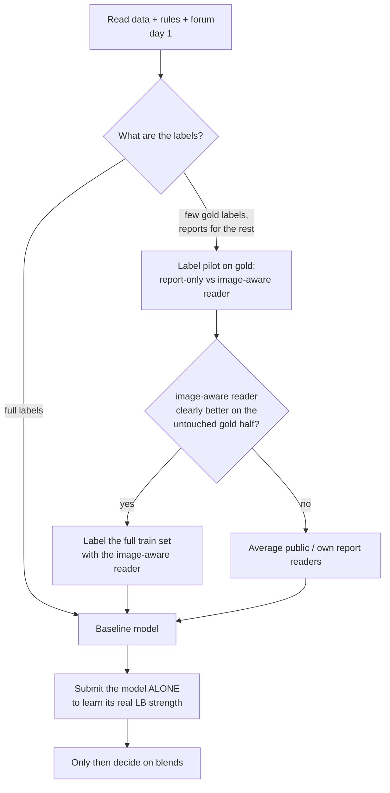

# 09 · Playbook for the next medical-imaging competition

[← index](README.md)

A checklist distilled from this competition. Each item links to the evidence.

## Week 1: understand where the signal is

1. **Read the data contract before modelling.** Slice order, orientation, physical scale, laterality, compressed
   DICOMs. Verify each on real files ([02](02_data_and_dicom.md)).
2. **Add guards against silent fallbacks** on day one: strict checkpoint loading, unreadable-study limits,
   constant-prediction checks. Our first score was 0.500 because of one.
3. **Run a label pilot on the gold set in week 1.** Compare a report-only reader with a reader that sees the images
   (a multimodal LLM or a radiologist-style rubric). The winners' gain came from here ([03](03_labels.md)).
4. **Split the gold set:** tune on one half, check on the untouched other half. Never select epochs, prompts or label
   recipes on all of it, and never measure labels that contain your own model's predictions on it.
5. **Submit your own model alone early.** Its standalone LB score decides whether blending can work at all
   ([05](05_blending_and_submission.md)).
6. **Label with headless agents, not per-token APIs.** The 1st and 5th place ran one `claude -p` / `codex exec` session
   per study under a subscription: slice sheets + a slice-viewer tool + a JSON schema that asks for evidence before the
   probability. Let an agent write and launch the sub-agent prompts ([11](11_top5_gap_analysis.md)).
7. **Align labels with the host's definitions:** "not addressed" is not negative; check low-grade / small findings against
   the gold set (5th: low-grade MCL 0/5 positive, small effusion 10/22); temperature-calibrate over-confident labels.
8. **Fold by site.** Cluster studies by scanner / hospital and keep each cluster in one fold; same-site leakage inflated
   local AUC by 0.019 for the 5th place.

## Modelling

9. Start with a simple strong recipe: 2.5D windows, ConvNeXt-T or EfficientNetV2-S, per-finding attention MIL,
   5 folds, ~25 epochs with EMA and a fixed endpoint (no epoch picking on gold). Bigger backbones and higher resolution were not the lever here.
10. Look where the finding is: ROI crops or knee-centred close-ups beat whole-field inputs (5th: +0.003 private from bone-segmentation crops; 1st: ROI detector + box pooling). nnU-Net / TotalSegmentator-MRI give bone masks quickly.
11. A blend member needs to be strong **and** different: with ρ ≈ 0.86 it must score ≈ 0.949 alone to add +0.002 to
   a 0.958 base. Seeds and folds of the same recipe (r ≈ 0.96) add almost nothing.
12. Mirror one knee side and never use random horizontal flips on medial/lateral targets.
13. Patch-14 ViTs (DINOv2) need a resolution divisible by 14.

## Leaderboard discipline

14. Public LB noise is about ±0.003 on ~640 studies; do not chase 0.001 moves.
15. Fix blend weights before running; do not tune per-finding weights on the gold set (goodpjw2008 measured −0.001 to −0.003).
16. Pick two finals that differ in kind (e.g. one tuned, one untuned) and mark them by hand.
17. Daily limits reset at UTC midnight. Scoring queues grow in the last week.
18. Copy or pin public inputs: public datasets can be overwritten after you depend on them.

## Infrastructure

19. One Python environment, activated by every script; check it in the first lines of every job.
20. Keep upload separate from training; a failed upload must never retrain a model.
21. Download large artefacts in small verified chunks; resume instead of restarting.
22. Long jobs run on the server, detached (`setsid nohup` or a private tmux socket), never on a laptop that sleeps.
23. Tokens live in files with `chmod 600`, are entered with `read -rs`, and are never pasted into chats or commands.
24. Plan GPU quota: 30 h per Kaggle account per week, 2 concurrent sessions; a local GPU is ~8× faster than a T4.

## External data

25. Check access for every team member early (OAI is blocked from some countries) and read the host's external-data
    ruling before building on a dataset or on public weights trained on it.
