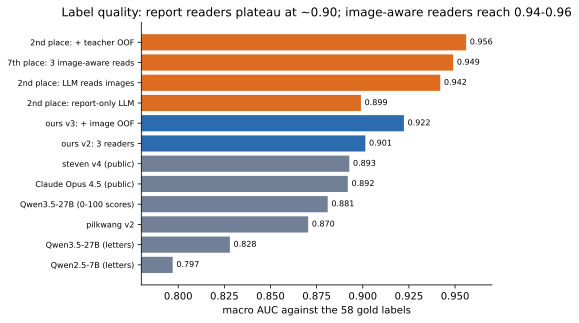
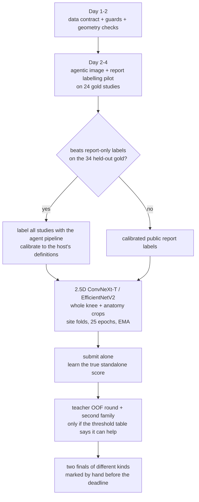

# 12 · Lessons learned

[← index](README.md)

Every lesson follows the same shape: **context → what we did → what happened → what the winners did → the rule for next time.**
Numbers are private-leaderboard AUC unless marked otherwise. Evidence pages: [07 · Experiment log](07_experiment_log.md),
[11 · Top-5 gap analysis](11_top5_gap_analysis.md).

## At a glance

| # | lesson | impact on us | rule |
|---|---|---|---|
| L1 | The labels decide the ceiling | ~0.008–0.010 | read the images when labelling |
| L2 | Agents beat per-token APIs for labelling | the reason we skipped L1 | `claude -p` / `codex exec`, one session per study |
| L3 | Labels must mean what the host means | ~0.010 (5th's calibration gain) | calibrate to the definitions; missing ≠ negative |
| L4 | 58 gold studies cannot steer decisions | weeks spent on v3 / v4 | split gold, fold by site, check LB early |
| L5 | Measure your own model alone, early | found out 3 days before the end | standalone submission in week 1 |
| L6 | A blend member must be strong and different | −0.001 … −0.005 per blend | use the threshold table before training |
| L7 | Look where the finding is | ~0.003 | ROI / anatomy crops |
| L8 | Do not train the base's family | ConvNeXt-T 0.959 vs CoAtNet 0.952 (2nd, public) | pick a different backbone family |
| L9 | Silent failures cost the most | LB 0.500 | guards on day one |
| L10 | Geometry is a contract | — (we got it right) | verify order, side and scale on real files |
| L11 | Infrastructure eats GPU hours | ~15 GPU hours lost | idempotent queues, separate uploads |
| L12 | Respect the data rules everywhere | a public repo leaked MR images | never commit outputs that show competition data |

---

## L1 · The labels decide the ceiling

**Context.** 58 of 4,407 studies had expert labels graded from the images; the rest had reports in 8+ languages.

**What we did.** Averaged public report-label sets (v2, gold 0.901) and mixed in our image models' out-of-fold
predictions (v3, gold 0.922; v4).

**What happened.** v3 moved the leaderboard by +0.001 (Raptor-80 alone: public 0.928 → 0.929, private 0.913 → 0.915).
v4 lost 0.003.

**What the winners did.** All of the top 5 had a multimodal LLM look at the MRI together with the report. 2nd place:
report-only 0.899 → images + report 0.942 → + teacher OOF 0.956 on gold. 5th place: better labels were the largest
step, +0.008 private.

**Rule.** In week 1, run a label pilot on gold: report-only reader vs image-aware reader. If the image-aware reader wins
on the untouched half, label everything with it before training any serious model.

## L2 · Agents beat per-token APIs for labelling

**Context.** We dropped image-aware labelling because a paid vision API for ~4,400 studies × dozens of images looked
too expensive.

**What happened.** We never tested the idea.

**What the winners did.** 5th place wrote that API calls would be expensive, so they ran `claude -p` and `codex exec`
in headless mode under their subscriptions, with an agent launching hundreds of sub-agents and writing their prompts.
1st place ran one non-interactive agent session per study: slice overview sheets, a slice viewer, a geometry tool, and
a JSON schema asking for evidence before the probability (median 2.5 minutes, ~15 images per study). They also
"trained a guide": one long session labels a gold study, sees the answer, rewrites a notes file, and after N cases
writes a reading guide used for the other studies.

**Rule.** Cost the labelling with the tools you already pay for. Build the per-study workspace (images + report + tools
+ schema) on day 2 and pilot on 24 gold studies.

## L3 · Labels must mean what the host means

**Context.** Report wording does not match the competition's definitions.

**What we did.** Averaged sources as they were.

**What the winners found (5th place).** One public table gave no answer for 27% of cells (84% for synovitis): missing
is not negative. The host's guide counts MCL only for acute high-grade tears, yet 199 low-grade reports were labelled
positive (0 of 5 such gold cases were positive). Only 10 of 22 small effusions were positive. Hedged "yes" values around
0.75 were right only 38% of the time. Calibrating the report labels to the gold rates raised a CoAtNet from 0.916 to
0.926 private, with nothing else changed. 1st place temperature-scaled over-confident labels (k ≈ 0.77).

**Rule.** Read the host's definitions first, encode "not addressed" separately, check severity thresholds against gold,
and calibrate per finding out-of-fold.

## L4 · 58 gold studies cannot steer decisions

**Context.** The 58 gold studies were the only ground truth.

**What we did.** Picked epochs, label versions and blends by gold AUC on all 58.

**What happened.** v3 looked +0.021 better on gold and was +0.001 on the leaderboard. Gold moves by about ±0.02 by chance.

**What the winners did.** 2nd place tuned on 24 and kept 34 untouched. 5th place used hospital-cluster folds (same-site
leakage inflated local AUC by 0.019). 1st place collected 20–30 leaderboard scores and checked which local metric
tracked them before trusting it. 3rd place used fixed training endpoints instead of picking the best gold epoch.

**Rule.** Split gold into tune / check, fold by site, never measure labels that contain your own model's predictions on
gold, and calibrate your local metric against a handful of leaderboard points.

## L5 · Measure your own model alone, early

**What happened.** We submitted our model alone for the first time on day 9 (0.928) and again three days before the end;
until then we inferred its strength from gold and blend results, and a formula fit gave a misleading 0.939.

**Rule.** The first serious model goes to the leaderboard alone in week 1. Its standalone score decides whether
blending can work at all (L6).

## L6 · A blend member must be strong and different

**What happened.** Every weight of our ≈0.929 model lowered the 0.958 base: 0.958 → 0.956 → 0.955 → 0.953 public
(0.942 → 0.937 private).

**Why.** With error correlation ρ ≈ 0.86 a new member needs ≈ 0.949 alone to add +0.002 (binormal model, see
[05](05_blending_and_submission.md)). Seeds and folds of one recipe correlate at r ≈ 0.96 and add almost nothing; 2nd
place saw a 0.959 look-alike member add nothing either.

**Rule.** Estimate ρ and the standalone score before training another member; prefer different inputs (crops, planes,
slice-level models) over more seeds.

## L7 · Look where the finding is

**What we did.** Fed the whole 140 mm field.

**What the winners did.** 1st: learned 3D ROI detector → 112 mm crop + box pooling (+0.0067 gold over a plain per-slice
model). 5th: nnU-Net bone segmentation (initialised from TotalSegmentator-MRI) → four anatomy crops at ~2× pixel density,
+0.003 private. 2nd: knee-centred close-ups, but a close-up alone lost 0.010 on Lateral Meniscus until the whole knee was
added back.

**Rule.** Whole knee + region crops, never crops alone. Bone masks are cheap with nnU-Net / TotalSegmentator.

## L8 · Do not train the base's family

**What we did.** Raptor-CoAtNet, the same family as the public base.

**What happened.** Weak (0.929) and highly correlated with the base.

**What the winners did.** ConvNeXt-T/S/B, EfficientNetV2-S/M, BiT ResNetV2-50, DINOv3 ViT-B, MambaOut; per-slice and
6-channel variants for diversity. In 2nd place's table ConvNeXt-T scored 0.959 public versus CoAtNet 0.952.

**Rule.** Choose a family that is absent from the public base and proven in similar competitions; vary the input
representation, not only the backbone.

## L9 · Silent failures cost the most

**What happened.** Our first submission scored 0.500: the kernel could not load the checkpoint and silently wrote prior
values. A three-model variant (10sh) later fell back to the base because its arms did not fit the time budget.

**Rule.** Strict loading, failure-rate limits, constant-prediction checks and per-stage time budgets that log loudly.

## L10 · Geometry is a contract

**What we did right.** Geometric slice order, orientation, mm scale, laterality with mirroring, verified on real files
(file-name order ρ ≈ −0.3 … +0.4; side from geometry agreed with tags 98.5%). A diagnostic notebook proved inference
reproduced training (gold 0.9227 vs 0.9205). Every top team did the same.

**Rule.** Keep this; it is the entry ticket, not the differentiator.

## L11 · Infrastructure eats GPU hours

**What happened.** A queue started without its Python environment (a lost night), an upload failure that retrained
every fold three times (~3 GPU hours), a watcher that missed a file (~3.5 idle GPU hours), dropped 3 GB downloads,
tmux sessions killed by other tooling, a laptop going to sleep with a scheduled job.

**Rule.** One environment activated by every script; upload separate from training; resumable, verified chunked
downloads; detached jobs on the server; check files by fetching them, not by listing.

## L12 · Respect the data rules everywhere

**What happened.** When the repository was made public, two executed notebooks still contained MR images and per-study
label rows. We stripped all notebook outputs from the entire git history and force-pushed.

**Rule.** Never commit notebook outputs that show competition data; strip outputs in a pre-commit hook. Tokens live in
`chmod 600` files and are typed with `read -rs`, never pasted.

---

## What we would do in a rerun, in order

