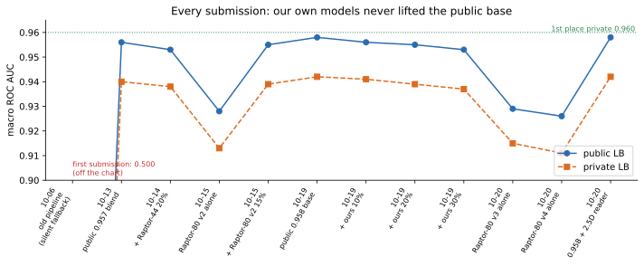
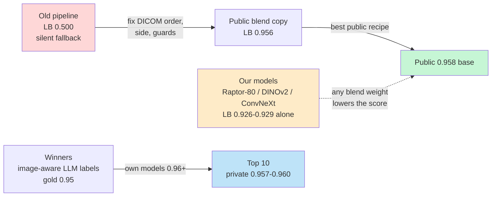

# Knowledge base: RSNA Knee Abnormality Detection (2026)

This folder is our reference for the next medical-imaging competition. It records what the task was, what we built,
what we measured, what the winners did differently and the checklist we want to follow next time.

> **Result:** private rank ≈ 1,730 / 6,425 · best public 0.958 / private 0.942 · 1st place private 0.960
> **Team:** theartificialteam (kadirov0, miraysudemutlu) · **Dates:** joined early October 2026, deadline 2026-10-22

## Start here

| If you want to know... | read |
|---|---|
| the task, the data traps and the metric in 5 minutes | [01 · Competition](01_competition.md) |
| how to read knee MRI DICOMs correctly | [02 · Data and DICOM preprocessing](02_data_and_dicom.md) |
| how training labels were built and why they were the bottleneck | [03 · Labels](03_labels.md) |
| which models we trained and how strong they were | [04 · Models](04_models.md) |
| how rank blending works and when a model helps a blend | [05 · Blending and submission](05_blending_and_submission.md) |
| Kaggle quotas, the GPU server and every infrastructure failure | [06 · Infrastructure](06_infrastructure.md) |
| the full chronological log with every number | [07 · Experiment log](07_experiment_log.md) |
| final standings and what the winners did | [08 · Results and winning solutions](08_results_and_winners.md) |
| **what to do differently next time** | [09 · Playbook](09_playbook.md) |
| terms and every source we read | [10 · Glossary and references](10_glossary_and_references.md) |

## The story in one picture





## The three lessons that matter most

1. **Labels were the whole game, and the best labels came from looking at the images.** Report-only labels plateau
   near 0.90 on the gold studies; the winners had vision LLMs read the MRI with the report and reached 0.94–0.956.
   See [03 · Labels](03_labels.md) and [08 · Results](08_results_and_winners.md).
2. **58 gold studies cannot steer decisions.** Our pseudo labels gained +0.021 on gold and +0.001 on the leaderboard.
   Split gold into tune / check halves and measure your own model alone on the leaderboard early.
   See [09 · Playbook](09_playbook.md).
3. **A blend member must be strong and different.** With error correlation ρ ≈ 0.86 a new member needs about
   0.949 public on its own to add +0.002 to a 0.958 base. See [05 · Blending](05_blending_and_submission.md).

## Regenerating the figures

```bash
python scripts/make_doc_figures.py
```
